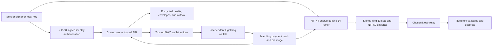

# NostrChat

**Private conversations. Lightning payments. One shared context.**

[Open the app](https://nostrchat-greyw0rks.vercel.app/) · [Source](https://github.com/greyw0rks/nostrchat/tree/main/apps/nostrchat)

A freelancer can agree on a task, share a Lightning invoice, review payment, and retain a verified receipt in the same private conversation. NostrChat brings that workflow to a lightweight interface with horizontal desktop navigation and a phone bottom bar.

## Start the complete local lab

Requires Linux x64, Node.js 22.12+, and pnpm. From the repository root:

```sh
./start.sh nostrchat
```

This installs locked dependencies, downloads checksum-pinned Bitcoin Core and LND, opens a private regtest Lightning channel, and starts the chat interface, API, and local Nostr relay. Open **http://127.0.0.1:4405**. Regtest sats have no monetary value.

After initial setup, run `pnpm dev -- nostrchat`. If another release owns port 4400, use an unused API port: `SATS_API_PORT=4424 pnpm dev -- nostrchat`. The app discovers that API's relay through its configuration endpoint. `SATS_CHAT_PORT` changes the interface port.

## A complete two-person exercise

1. Open two separate browser contexts. Create a key in each, choose a backup passphrase, and save the encrypted backup before opening the inbox. A compatible NIP-07 signer can be used instead.
2. In **Settings → Identity**, copy each public npub. Add the other person through **New conversation**. Public keys are addresses for encryption; they do not establish someone's real-world identity.
3. Send a message. The sender and recipient receive separate, signed NIP-59 gift wraps containing the same NIP-17 private message. A relay acknowledgement means publication, not a read receipt.
4. Open the wallet. On the local lab, connect Alice on one account and Bob on the other. Public production requires a supported, narrowly permissioned NWC connection.
5. On the receiving account, create a fixed-amount invoice and share it in the conversation. On the payer, select **Review payment**, inspect the sats, Bitcoin network, and wallet reference, then explicitly confirm.
6. A paid state requires a preimage whose SHA-256 matches the payment hash. The receiving account can separately check its own wallet, and the payer sends the verified proof back as an encrypted conversation receipt.
7. Lock and reopen the account using its encrypted backup. Restore the same contacts, encrypted history, and payment recovery records. An uncertain payment offers a status check; it is never automatically sent again.

The complete local lab is usable without a paid service, public relay, or live Bitcoin. Production uses Convex and a chosen WSS message relay. Both participants must select the same relay in this version.

## Identity and wallet support

**Identity:** Connect and other NIP-07 signers must expose `getPublicKey`, `signEvent`, and NIP-44 `encrypt`/`decrypt`. Late extension injection is supported. Local keys are real Nostr identities; only a NIP-49 encrypted backup persists. The passphrase and unencrypted key remain in memory. Locking destroys the application's active local key.

**Lightning:** NWC/NIP-47 supplies wallet interoperability. Receive permissions require `make_invoice` and `lookup_invoice`; payment requires `pay_invoice` and `lookup_invoice`. Balance is optional. The server checks provider-reported capabilities, network, wallet public key, and a connection fingerprint. Supported wallet relay hosts are operator allowlisted.

Connect's signer can identify a chat account. This chat wallet adapter uses NWC; it does not turn Connect's WebLN interface into a remote NWC service. The company, academy, and chat wallet connections have separate storage and encryption scopes.

Use a provider-enforced spending budget and narrow permissions. The trusted server possesses a delegated NWC credential, which is encrypted at rest. An application confirmation is not a cryptographic restriction on that credential. No Bitcoin wallet seed phrase is requested.

## Architecture



The browser encrypts message text before relay publication. The backend stores encrypted profiles, ciphertext outbox records, signed encrypted envelopes, and payment records. Wallet operations execute in trusted server actions. Session and account checks run around asynchronous operations; immutable payment reviews bind owner, invoice, network, and wallet version. Atomic claims prevent concurrent confirmations from issuing two payments.

## Working product features

- Landing and onboarding, create/connect/unlock/restore, mandatory new-key backup, explicit lock, and account settings.
- Contact create/edit/remove, private display names, contact and conversation search, and invoice filters.
- Encrypted one-to-one messages, sender copies, signature/recipient verification, bounded caching, acknowledgement, reconnect, and queued publication recovery.
- Encrypted profile synchronization with optimistic revisions; owner-scoped cloud history and outbox pagination; export/import and device/cache controls.
- Wallet capability and network display, optional balance, invoice QR, private invoice sharing, fixed payment review, explicit confirmation, and verifiable receipts.
- Activity filters and durable uncertain-payment recovery, including standalone pasted invoices after reload and invoice expiry.
- Local bundled fonts, visible focus, modal keyboard handling, reduced-motion support, and responsive layouts.

## Verification

```sh
pnpm typecheck:nostrchat
pnpm typecheck:convex
pnpm test
pnpm build:release
```

The [retained integration run](../evidence/nostrchat-regtest.json) completed 19 end-to-end checks using generated builder identities, a private relay, and two real LND regtest wallets. A 100-sat invoice was delivered in encrypted chat, paid once, verified by both wallets, and followed by a matching encrypted receipt. This is technical evidence, not independent adoption or mainnet settlement.

Model/HTTP tests cover owner isolation, revision conflicts, ciphertext/signature checks, wallet changes, replay, expired reviews, concurrent payment claims, proof validation, and unknown-payment reconciliation. Protocol tests cover cryptographic envelope handling and rejected attacks. Browser verification measures the actual interface separately.

## Constraints and next iteration

Read [SECURITY.md](SECURITY.md) and [PRIVACY.md](PRIVACY.md). Relays observe public recipient tags, subscriptions, IP addresses, and timing. NIP-44 encryption does not provide metadata anonymity or forward secrecy. This release uses one chosen relay per account and has no relay discovery, groups, file uploads, read receipts, refunds, or recurring debits.

Limits are deliberate: 4,000-byte text messages, a 1,000-message in-memory view, 500 local encrypted envelopes, 2,000 cloud envelopes within 2 MB, and 100 cloud outbox items. Clear/export controls and paginated cloud reads expose these bounds. Payment records survive review cleanup and wallet disconnect; expired reviews cannot authorize new payment.

Next, test with independent freelancers on weak connections, measure first-message completion and invoice-to-payment time, add relay discovery/redundancy, and obtain an independent review of signer and delegated-wallet handling. Track uncertain-payment recovery and duplicate-payment avoidance. No user counts, local reach, or independent audits have been claimed.
